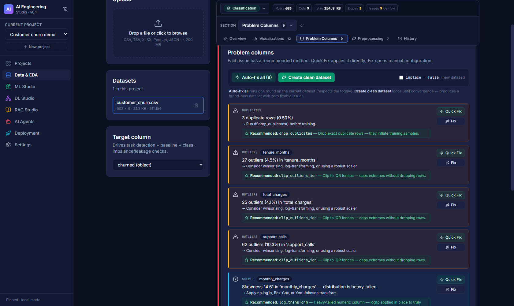
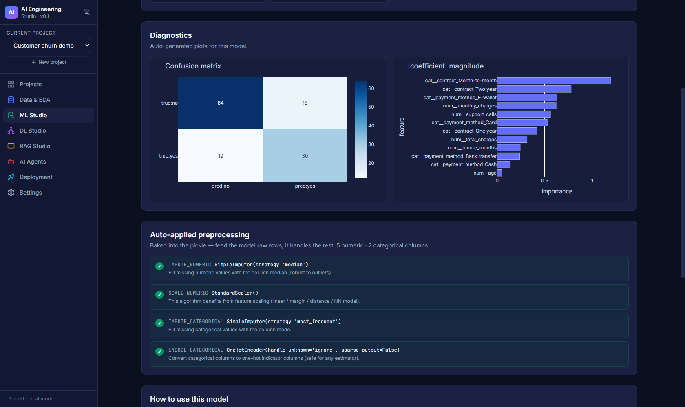
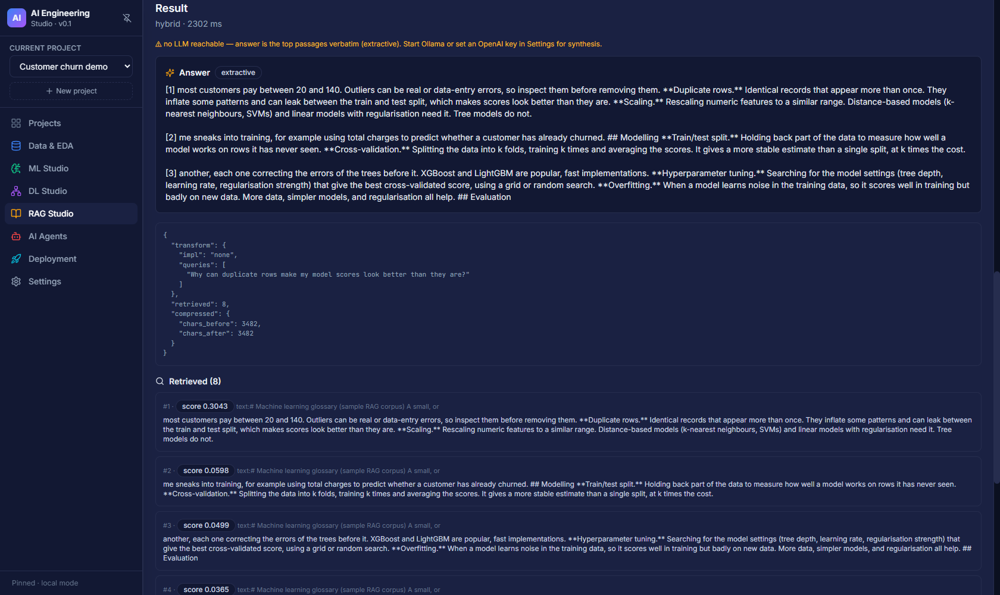
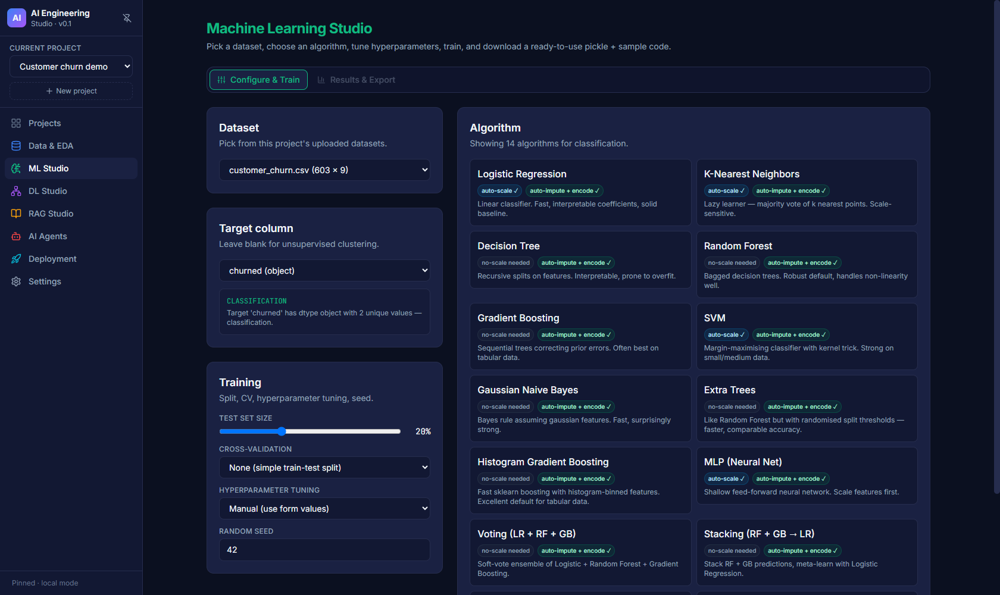
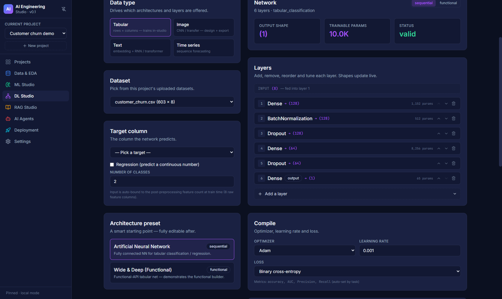

# AI Engineering Studio

[](https://github.com/spideyyy-man/ai-engineering-studio/actions/workflows/ci.yml)
[](LICENSE)

A local, developer-friendly web app for prototyping **machine learning**, **deep learning** and **RAG** systems through guided screens, with **readable, exportable Python code at every step**.

Most AutoML tools hide what they do. This one shows you the data issues it found, *why* it recommends a preprocessing step, the model and metrics it produced, and the code to reproduce all of it, so you learn while you build and you own the result.

**Who it's for:** ML and AI engineers who want a quick baseline or prototype, and students or small teams learning how real pipelines fit together.

> **Status: early alpha.** Data, ML, DL and RAG work end to end. Agents and Deployment are placeholders. Expect rough edges, and please report them.



<table>
  <tr>
    <td></td>
    <td></td>
  </tr>
  <tr>
    <td align="center"><sub>ML Studio: diagnostics after training on the sample churn data</sub></td>
    <td align="center"><sub>RAG Studio: hybrid retrieval over the sample glossary</sub></td>
  </tr>
  <tr>
    <td></td>
    <td></td>
  </tr>
  <tr>
    <td align="center"><sub>ML Studio: pick a target and one of 30+ algorithms</sub></td>
    <td align="center"><sub>DL Studio: edit layers, check shapes, export Keras code</sub></td>
  </tr>
</table>

---

## What works today

| Studio | Status | What you can do |
|---|---|---|
| **Data Engineering & EDA** | ✅ Working | Upload CSV / TSV / Excel / Parquet / JSON. Profile columns, detect quality issues, get preprocessing recommendations, apply fixes with history and undo, detect the task type, compute a baseline, and export a scikit-learn preprocessing script. |
| **Machine Learning** | ✅ Working | Train classification, regression and clustering models (scikit-learn, XGBoost, LightGBM) with automatic preprocessing, cross-validation and grid-based tuning. Download the pickled pipeline and a usage script. |
| **Deep Learning** | 🟡 Partial | Pick a preset (ANN, Wide & Deep, CNN, ResNet50 transfer, LSTM, GRU, Transformer, time-series LSTM), edit layers, check shapes, and export runnable Keras code. In-app training works for **tabular** data only and needs TensorFlow installed. |
| **RAG Engineering** | 🟡 Partial | Ingest pasted text, web pages, or local `.txt` / `.md` / `.csv` files. Choose fixed, recursive, sentence or semantic chunking, then retrieve with dense (TF-IDF), sparse (BM25), hybrid (RRF) or MMR. Optional query rewriting, LLM reranking and answer generation through Ollama or OpenAI. FAISS, Chroma, Qdrant and PDF/DOCX parsing are **not wired up yet**. |
| **AI Agents** | ⏳ Planned | Shows the planned agent types and tools only. The API returns "not implemented". |
| **Deployment & MLOps** | ⏳ Planned | Shows the planned deployment targets only. The API returns "not implemented". |
| **Projects Hub** | ✅ Working | Create, rename and delete projects. Every dataset, model and index belongs to a project. |
| **Settings** | ✅ Working | Read-only view of the configured providers, plus an LLM connectivity check. |

See [docs/ROADMAP.md](docs/ROADMAP.md) for what's planned next.

---

## Tech stack

- **Frontend:** React 18, Vite, TypeScript (strict), Tailwind CSS, Zustand, Plotly.js, axios
- **Backend:** FastAPI, SQLAlchemy 2, Pydantic 2, pandas, scikit-learn, XGBoost, LightGBM, TensorFlow/Keras (optional at runtime), Jinja2 for code generation
- **LLMs and embeddings:** Ollama by default (`llama3`, `nomic-embed-text`), OpenAI optional
- **Database:** SQLite, created automatically in `backend/storage/`
- **Storage:** local files under `backend/storage/projects/<project-id>/`

Architecture details: [docs/ARCHITECTURE.md](docs/ARCHITECTURE.md) · API: [docs/API.md](docs/API.md) · Database: [docs/DB_SCHEMA.md](docs/DB_SCHEMA.md)

> Some of those docs describe the *target* design (for example the FAISS/Chroma/Qdrant adapters and an Anthropic provider). Where they disagree with the table above, the table is the current truth.

---

## Quick start

Requirements: Python 3.11 or newer (3.11–3.12 if you want TensorFlow), Node.js 20.19+ or 22.13+, and optionally [Ollama](https://ollama.com) for the LLM features.

### 1. Configure

```bash
cp .env.example .env
```

The defaults work for local use. Fill in `OPENAI_API_KEY` only if you want OpenAI.

### 2. Backend

```bash
cd backend
python -m venv .venv
.\.venv\Scripts\activate         # Windows PowerShell
# source .venv/bin/activate      # macOS/Linux
pip install -r requirements.txt
# optional, for in-app Deep Learning training (Python 3.9-3.12 only):
# pip install -r requirements-dl.txt
uvicorn app.main:app --reload --port 8000
```

The API runs at <http://localhost:8000>, with interactive docs at <http://localhost:8000/docs>.

> Without TensorFlow, DL Studio still scaffolds, validates and exports Keras code. Only in-app training needs `requirements-dl.txt`.

### 3. Frontend

```bash
cd frontend
npm install
npm run dev
```

The UI runs at <http://localhost:5180>.

### 4. Try it with the sample data

The [`samples/`](samples) folder has data to play with straight away:

- **`customer_churn.csv`**: 600 synthetic customers with a yes/no `churned` target and some deliberate problems (missing values, duplicates, an outlier, an ID column). Upload it in **Data & EDA**, set the target to `churned`, fix the issues, then train a model in **ML Studio**.
- **`ml_glossary.md`**: a short ML glossary. Paste it into **RAG Studio** as a text source and ask questions like "Why can duplicate rows make my scores look better?"

### 5. (Optional) Ollama for RAG answers

```bash
ollama serve
ollama pull llama3
ollama pull nomic-embed-text
```

### Docker

```bash
docker compose up --build
```

Then open <http://localhost:5180>. The frontend container is nginx serving the built app and forwarding `/api` to the backend, so there's only one address to use.

- Add `--profile ollama` to also start an Ollama container, and set `OLLAMA_BASE_URL=http://ollama:11434` in `.env` so the backend can reach it.
- To include TensorFlow in the backend image, set `INSTALL_DL: "true"` under `backend.build.args` in `docker-compose.yml`.
- Your data (and the SQLite database) is kept in `backend/storage/` on your machine.

CI builds and starts the Docker setup on every push and checks the API through nginx.

---

## Development

```bash
# backend: lint + tests
cd backend
pip install -r requirements-dev.txt
ruff check .
pytest

# frontend: lint + type-check + build
cd frontend
npm run lint
npm run build
```

GitHub Actions runs the same checks on every push and pull request, plus a Docker build and smoke test (`.github/workflows/ci.yml`). The tests use a throwaway storage folder and never call a real LLM.

---

## Security notes

This is a **local, single-user tool**. It has **no login**, so:

- Keep it on your own machine. `docker-compose.yml` binds every port to `127.0.0.1` for that reason, and `uvicorn` binds to localhost by default. Don't expose it to a network or the internet.
- The RAG file loader only reads text files inside `backend/storage/`. To let it read another folder, add it to `RAG_ALLOWED_DIRS` in `.env`.
- The RAG URL loader refuses localhost and private-network addresses unless you set `RAG_ALLOW_PRIVATE_URLS=true`.
- Uploads are capped by `MAX_UPLOAD_MB` (default 200 MB).
- Models are saved with pickle. Only load model files that this app created.

Found a security problem? Please report it privately, as described in [SECURITY.md](SECURITY.md).

---

## Repository layout

```
backend/
  app/
    routers/      HTTP endpoints, one file per studio (thin)
    services/     the real logic: data_engineering, ml_studio, dl_studio, rag_studio, llm, codegen
    models/       SQLAlchemy tables
    schemas/      Pydantic request/response models
    core/         errors, logging, storage paths
  tests/          pytest suite (API + safety checks)
  storage/        created at runtime (datasets, models, indexes, SQLite DB)
frontend/
  src/
    pages/        one page per studio
    components/   shared UI
    api/          typed API client, one module per router
    store/        Zustand stores
samples/          sample dataset and RAG corpus
docs/             architecture, API, DB schema, roadmap, screenshots
```

---

## Contributing

Contributions are welcome! Read [CONTRIBUTING.md](CONTRIBUTING.md) for setup and guidelines, and look for issues labelled [`good first issue`](https://github.com/spideyyy-man/ai-engineering-studio/issues?q=is%3Aissue+is%3Aopen+label%3A%22good+first+issue%22). Good places to start:

- Wire up a real vector store (FAISS or Chroma) in `services/rag_studio/`
- Add PDF/DOCX loading to RAG Studio
- Build the first Deployment generator: a FastAPI `/predict` service for a trained ML model
- Add tests for the parts that aren't covered yet (auto-fix, transforms and undo, DL training)

Open an issue first for anything large, so we can agree on the approach. Everyone taking part is expected to follow the [Code of Conduct](CODE_OF_CONDUCT.md).

---

## License

[MIT](LICENSE) © 2026 spideyyy-man and AI Engineering Studio contributors
